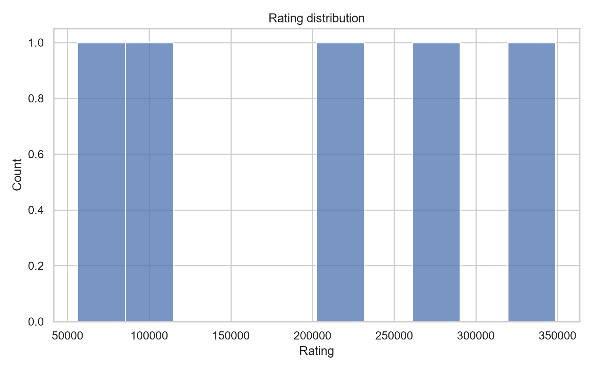
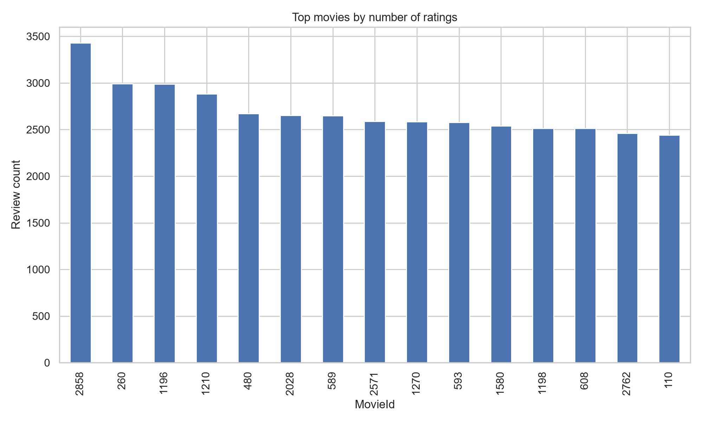
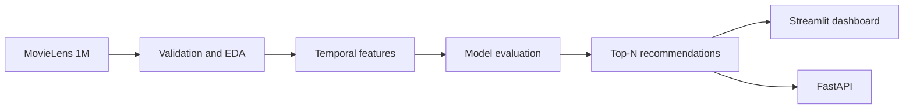

# Movie Recommendation System

An end-to-end movie recommendation project using MovieLens 1M. It covers data quality, leakage-aware temporal validation, model comparison, personalized Top-N recommendations, a live Streamlit app, and a FastAPI service.

[](https://github.com/rodriguesruan/movie-recommendation-system/actions/workflows/tests.yml)
[](https://movie-recommendation-system-9pis.onrender.com)

**Live demo:** [movie-recommendation-system-9pis.onrender.com](https://movie-recommendation-system-9pis.onrender.com)

**API docs (local):** [OpenAPI / Swagger](http://127.0.0.1:8000/docs) after starting FastAPI below.

**Dataset:** [GroupLens MovieLens 1M](https://files.grouplens.org/datasets/movielens/ml-1m.zip)

> The free Render service may sleep when idle. Its first request after inactivity can take longer while the app starts, downloads data if needed, and trains the serving model.

## Project Highlights

- 1,000,209 ratings across 6,040 users and 3,883 movie records.
- Strict chronological train/validation split; equal timestamps are never divided across the boundary.
- Historical user/item features exclude the rating being predicted and all later events.
- Random Forest predictions rank unseen movies; explanations cite actual user and movie rating history.
- FastAPI endpoints and an interactive Streamlit dashboard.
- GitHub Actions runs the test suite on pushes and pull requests. Raw MovieLens files are downloaded in CI and are not stored in Git.

## Evaluation Results

Results below use a strict chronological holdout on the official MovieLens 1M ratings: 800,168 training events and 200,041 later validation events. The Random Forest is trained on a deterministic sample of up to 30,000 training rows to match the resource-bounded serving configuration.

| Model | RMSE ↓ | MAE ↓ | R² ↑ |
| --- | ---: | ---: | ---: |
| Global mean baseline | 1.1043 | 0.9195 | -0.0016 |
| Smoothed user/item bias | **0.9590** | **0.7585** | **0.2447** |
| Serving Random Forest | 0.9766 | 0.7844 | 0.2165 |

The current Random Forest does **not** beat the simpler user/item-bias baseline on this rating-prediction holdout. This is reported transparently; the serving recommender currently uses the Random Forest score, and Top-K ranking metrics such as Precision@K have not yet been evaluated. Full protocol and results: [reports/model_evaluation.md](reports/model_evaluation.md). Reproduce with `python -m src.validation.evaluate`.

## Exploratory Analysis

The data quality audit found no missing values or duplicate rows in the three MovieLens tables. Ratings range from 1 to 5; 3,706 of the 3,883 movie records have at least one rating.

| Rating distribution | Most-rated movies |
| --- | --- |
|  |  |

Additional plots are available in [reports/figures](reports/figures/).

## How It Works

1. Load and validate MovieLens ratings, movies, and users.
2. Sort interactions by timestamp and construct user/item history from prior events only.
3. Compare global mean, smoothed user/item bias, and Random Forest on a forward-in-time holdout.
4. Score unseen movies for a selected user, rank the Top-N, and explain scores with observed history.
5. Serve the dashboard on Render and expose the local API through FastAPI.

The workflow is:



## Run Locally

Requires Python 3.11 or newer.

```powershell
git clone https://github.com/rodriguesruan/movie-recommendation-system.git
cd movie-recommendation-system
python -m venv .venv
.\.venv\Scripts\Activate.ps1
python -m pip install -r requirements.txt
```

The app downloads the official dataset to `data/raw/ml-1m` if it is missing. Raw data is ignored by Git.

Start the dashboard:

```powershell
streamlit run streamlit_app.py
```

Start the API in a separate terminal:

```powershell
uvicorn src.api:app --reload
```

| Endpoint | Description |
| --- | --- |
| `GET /health` | API health check |
| `GET /recommendations/{user_id}?top_n=10` | Recommendations for a known user; `top_n` range is 1–50 |
| `/docs` | Interactive OpenAPI documentation |

Run all tests with `python -m pytest -q`. Reproduce the model comparison with `python -m src.validation.evaluate`.

## Tech Stack

Python · pandas · NumPy · scikit-learn · FastAPI · Streamlit · pytest · GitHub Actions · Render

## Repository Layout

```text
src/data/                 MovieLens loading and bootstrap
src/validation/           Quality, temporal features, models, evaluation, recommendations
tests/                    Unit and API tests
reports/                  Data quality, model evaluation, and EDA figures
notebooks/                Exploratory analysis notebook
streamlit_app.py          Interactive dashboard
render.yaml               Render deployment blueprint
```

## Limitations and Next Steps

- The serving score predicts a rating; it is not yet optimized or evaluated as a ranking objective.
- The user/item-bias baseline currently outperforms the Random Forest on the temporal rating holdout.
- The free Render instance can sleep when idle, and the model is retrained after a cold start.
- Next model milestone: compare ranking metrics (Precision@K, Recall@K, and NDCG@K) and promote a model only when it beats the baseline on a temporal evaluation.

## License and Data

MovieLens 1M is provided by [GroupLens Research](https://grouplens.org/datasets/movielens/1m/). Dataset terms remain those of the provider. The project code is provided for educational and portfolio use.
